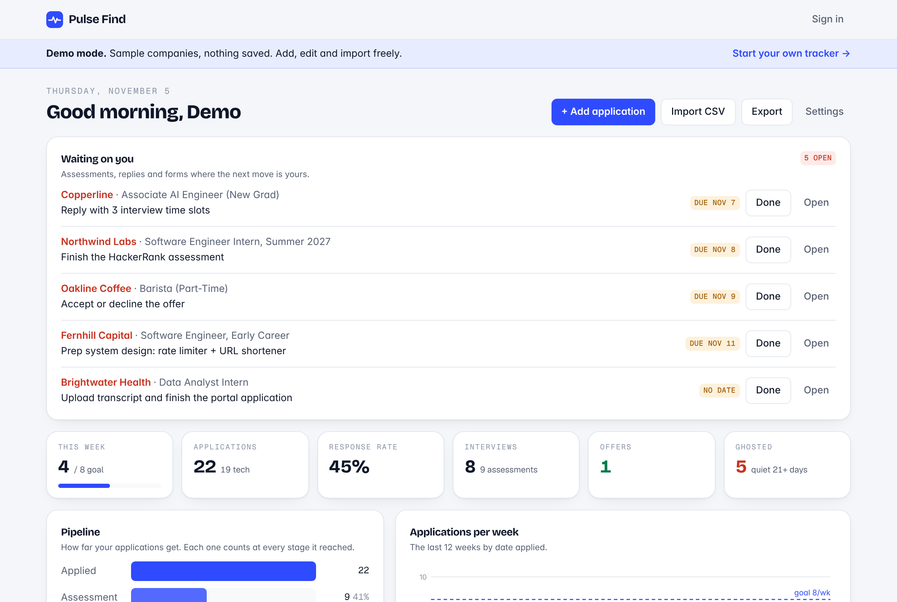
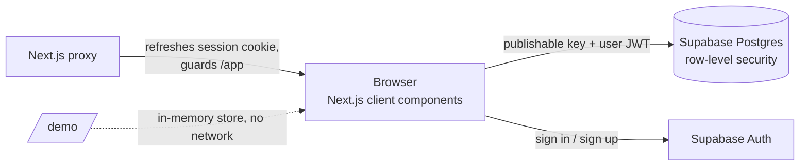

<p align="center">
  
</p>

<h1 align="center">Pulse Find</h1>

<p align="center">
  A job application tracker that tells you what's waiting on you.<br />
  <a href="https://pulsefind-app.vercel.app"><b>Live site</b></a> ·
  <a href="https://pulsefind-app.vercel.app/demo"><b>Try the demo</b></a> (no sign-up)
</p>

<p align="center">
  <a href="https://github.com/kumailrizvi890/Pulse-Find/actions/workflows/ci.yml"></a>
  
  
  
</p>



## Why

Spreadsheets are fine at *storing* applications and bad at telling you what to do next. In a real search the costly misses are small: an online assessment that expires on Friday, a recruiter waiting on your availability, a company that went quiet three weeks ago and never got a follow-up.

Pulse Find puts those at the top of the page.

## Features

- **Waiting on you.** One queue of everything where the next move is yours (assessments, interview scheduling, unfinished portals, offers to answer), soonest deadline first, with overdue items called out.
- **Ghost detection.** Every application counts days since you last heard back. Past your threshold (21 days by default, adjustable) it's flagged *Ghosted*; past half, *Follow up soon*. Closed applications are never flagged.
- **Pipeline and pace.** A stage funnel (applied → assessment → interview → offer) and a 12-week chart against your weekly goal, with tech roles split out automatically.
- **Bring your spreadsheet.** CSV import that understands other people's column names (`Employer`, `Stage`, `Next Step`…) and messy dates (`Oct 28`, `10/28/26`). Rows it can't use are reported, not silently dropped.
- **Export that looks right everywhere.** Excel export writes colors directly onto cells instead of using formula-based rules, so it renders the same in Excel, Numbers, Google Sheets and phone previews. CSV export guards against spreadsheet formula injection.
- **Public demo.** `/demo` runs the full dashboard on invented sample data, entirely in the browser.
- **Private by default.** Postgres row-level security on every table. Light and dark themes, works on phones.

## Architecture



- **One UI, two stores.** The dashboard talks to a small `TrackerStore` interface (`src/lib/store.ts`). The demo uses an in-memory implementation; signed-in users get a Supabase one. Same components, same code paths.
- **Logic is pure and tested.** Follow-up flags, the funnel, weekly buckets, tech-role detection, CSV parsing and export escaping live in `src/lib` as plain functions with unit tests (`npm test`).
- **Security is enforced in the database.** Each table has `select / insert / update / delete` policies scoped to `auth.uid()`. The events policy also checks that the parent application belongs to the same user. Supabase's security advisor reports no issues. See [`supabase/migrations`](supabase/migrations).
- **Dates are calendar dates.** Stored as `date`, handled as `YYYY-MM-DD` strings, so a deadline never shifts a day because of time zones.

## Stack

Next.js 16 (App Router) · React 19 · TypeScript · Tailwind CSS 4 · Supabase (Postgres, Auth, RLS) · ExcelJS · Papa Parse · Vitest · GitHub Actions · Vercel

## Run it locally

```bash
git clone https://github.com/kumailrizvi890/Pulse-Find.git
cd Pulse-Find
npm install
cp .env.example .env.local   # add your Supabase URL and publishable key
npm run dev
```

The demo at `http://localhost:3000/demo` works without any Supabase setup.

To use accounts, create a Supabase project and run the SQL in `supabase/migrations/` (SQL editor, or `supabase db push`).

| Script | What it does |
| --- | --- |
| `npm run dev` | Start the dev server |
| `npm test` | Unit tests (Vitest) |
| `npm run lint` / `npm run typecheck` | ESLint / TypeScript |
| `npm run build` | Production build |

## Roadmap

- [ ] **Email forwarding.** A personal inbound address per user; forwarded job emails are classified (confirmation, assessment, interview, rejection, offer) and update the tracker. This avoids Gmail's restricted-scope review entirely.
- [ ] Password reset and Google sign-in
- [ ] Reminders the day before an action is due
- [ ] Optional Gmail connect for invited testers

## Author

Built by [Syed Kumail Rizvi](https://portfolio-kumailr.vercel.app), CS student at the University of Washington Bothell. It started as the spreadsheet and automations I used for my own internship search.

MIT licensed.
