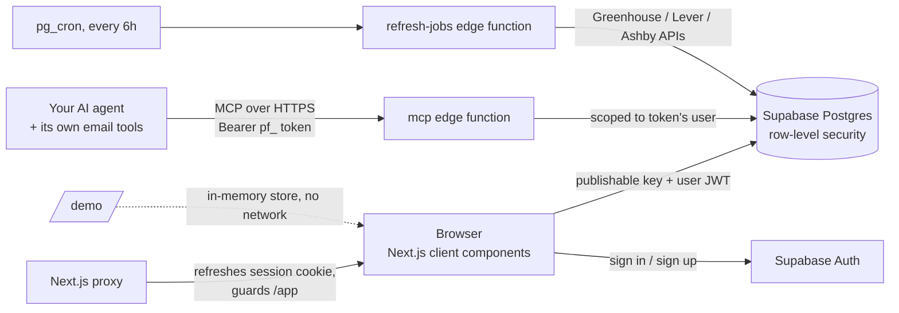

<p align="center">
  
</p>

<h1 align="center">Pulse Find</h1>

<p align="center">
  A job application tracker that tells you what's waiting on you,<br />
  and an MCP server so the AI agent you already use can keep it current from your email.<br />
  <a href="https://pulse-find-two.vercel.app"><b>Live app</b></a> ·
  <a href="https://pulse-find-two.vercel.app/demo"><b>Try the demo</b></a> (no sign-up) ·
  <a href="https://pulse-find-two.vercel.app/jobs"><b>Job board</b></a> ·
  <a href="docs/SELF_HOST.md"><b>Self-host</b></a>
</p>

<p align="center">
  <a href="https://github.com/kumailrizvi890/Pulse-Find/actions/workflows/ci.yml"></a>
  
  
  
  
</p>


## The 10-second version

**Pulse Find is the tracker I run my own internship search on.** I built it because my spreadsheet kept letting things slip — an assessment about to expire, a recruiter waiting on a reply, a company that had gone quiet weeks ago. Now it's the first thing I open every day of my search: it shows me what's waiting on me, which deadlines are close, and who has ghosted — and my AI assistant keeps it current from my inbox through the built-in MCP server.

- **Waiting-on-you queue** — every assessment, reply and unfinished application in one list, soonest deadline first
- **MCP server built in** — Claude, Cursor or any MCP client syncs the tracker straight from job email; Pulse Find itself never reads your inbox and needs no AI API key
- **Ghost detection and pipeline stats** — days-since-contact follow-up flags, a stage funnel, and weekly pace against your goal
- **Live job board** — ~14,000 openings pulled from company Greenhouse, Lever and Ashby boards, one click to start tracking

**Stack:** Next.js 16 · React 19 · TypeScript · Supabase (Postgres, Auth, RLS, Edge Functions) · Model Context Protocol · Vitest · GitHub Actions CI

**Try it:** [Live app](https://pulse-find-two.vercel.app) · [Demo, no sign-up](https://pulse-find-two.vercel.app/demo) · [Job board](https://pulse-find-two.vercel.app/jobs)

## Why

Spreadsheets are fine at *storing* applications and bad at telling you what to do next. In a real search the costly misses are small: an online assessment that expires on Friday, a recruiter waiting on your availability, a company that went quiet three weeks ago and never got a follow-up.

Pulse Find puts those at the top of the page.

## Bring your own agent

Pulse Find doesn't call any AI API and never touches your inbox. Instead it's an [MCP](https://modelcontextprotocol.io) server: you hand an access token to the agent you already use (Claude, Cursor, VS Code Copilot, anything that speaks MCP), and that agent reads your email with its own tools and reports what it finds.

```bash
# Claude Code: create a token at https://pulse-find-two.vercel.app/app/connect
claude mcp add --transport http pulse-find https://pulse-find-two.vercel.app/api/mcp \
  --header "Authorization: Bearer pf_..."
```

Then: *"Scan my email from the last week and update Pulse Find."*

| Tool | What it does |
| --- | --- |
| `process_job_email` | Classifies one email (confirmation, assessment, interview, reminder, rejection, offer), matches it to the right application, sets what's waiting on you with the deadline, and checks it for job-scam signs. Idempotent by message id; `dry_run` to preview. |
| `get_summary` | Totals, response rate, ghosted companies, and everything waiting on you, soonest first |
| `list_applications` · `add_application` · `update_application` | Read and edit the tracker |
| `check_job_scam` | Fake-offer signals: check deposits, equipment reimbursement, chat-app interviews, fees, personal email domains |
| `search_jobs` | Live internship and new-grad postings from 50+ company career pages, refreshed every 6 hours |

Plus a `scan_inbox` prompt, and a ready-made agent playbook in [`skills/pulse-find/SKILL.md`](skills/pulse-find/SKILL.md). Agents are instructed to stay read-only in your inbox and never send email or apply for you.

Want your own copy? [Self-hosting guide](docs/SELF_HOST.md): free Supabase + Vercel, one Deploy button.

## Features

- **Waiting on you.** One queue of everything where the next move is yours (assessments, interview scheduling, unfinished portals, offers to answer), soonest deadline first, with overdue items called out.
- **Ghost detection.** Every application counts days since you last heard back. Past your threshold (21 days by default, adjustable) it's flagged *Ghosted*; past half, *Follow up soon*. Closed applications are never flagged.
- **Pipeline and pace.** A stage funnel (applied → assessment → interview → offer) and a 12-week chart against your weekly goal, with tech roles split out automatically.
- **Bring your spreadsheet.** CSV import that understands other people's column names (`Employer`, `Stage`, `Next Step`…) and messy dates (`Oct 28`, `10/28/26`). Rows it can't use are reported, not silently dropped.
- **Export that looks right everywhere.** Excel export writes colors directly onto cells instead of using formula-based rules, so it renders the same in Excel, Numbers, Google Sheets and phone previews. CSV export guards against spreadsheet formula injection.
- **Job board.** `/jobs` searches ~14,000 open roles pulled straight from company Greenhouse, Lever and Ashby boards, with internship, new-grad, remote and tech-only filters. Mark one "Applied" and it lands in your tracker.
- **Agent access.** Personal access tokens (only a SHA-256 fingerprint is stored, revocable any time) for the MCP server above.
- **Public demo.** `/demo` runs the full dashboard on invented sample data, entirely in the browser.
- **Private by default.** Postgres row-level security on every table. Light and dark themes, works on phones.

## Architecture



- **One UI, two stores.** The dashboard talks to a small `TrackerStore` interface (`src/lib/store.ts`). The demo uses an in-memory implementation; signed-in users get a Supabase one. Same components, same code paths.
- **Logic is pure and tested.** Follow-up flags, the funnel, weekly buckets, tech-role detection, CSV parsing and export escaping live in `src/lib` as plain functions with unit tests (`npm test`).
- **Security is enforced in the database.** Each table has `select / insert / update / delete` policies scoped to `auth.uid()`. The events policy also checks that the parent application belongs to the same user. Supabase's security advisor reports no issues. See [`supabase/migrations`](supabase/migrations).
- **One email engine, three runtimes.** The classifier, deadline parser, application matcher and scam check (`supabase/functions/_shared/email.ts`) are dependency-free TypeScript run by the Deno edge function and the Vitest suite alike. Updates never move an application backward (a late "thanks for applying" can't undo an interview invite), except rejections and offers.
- **MCP done by the spec.** Streamable HTTP with plain JSON responses, batches and notifications, tested against the official `@modelcontextprotocol/sdk` client. The function uses the service role but every query is filtered by the token's user id.
- **Dates are calendar dates.** Stored as `date`, handled as `YYYY-MM-DD` strings, so a deadline never shifts a day because of time zones.

## Stack

Next.js 16 (App Router) · React 19 · TypeScript · Tailwind CSS 4 · Supabase (Postgres, Auth, RLS, Edge Functions, pg_cron) · Model Context Protocol · ExcelJS · Papa Parse · Vitest · GitHub Actions · Vercel

## Run it locally

```bash
git clone https://github.com/kumailrizvi890/Pulse-Find.git
cd Pulse-Find
npm install
cp .env.example .env.local   # add your Supabase URL and publishable key
npm run dev
```

The demo at `http://localhost:3000/demo` works without any Supabase setup.

To use accounts, the job board and the MCP server, follow the [self-hosting guide](docs/SELF_HOST.md).

| Script | What it does |
| --- | --- |
| `npm run dev` | Start the dev server |
| `npm test` | Unit tests (Vitest) |
| `npm run lint` / `npm run typecheck` | ESLint / TypeScript |
| `npm run build` | Production build |

## Roadmap

- [x] MCP server so any AI agent can sync job email
- [x] Live job board from company career pages
- [ ] **Email forwarding.** A personal inbound address per user, run through the same classifier, for people without an agent
- [ ] OAuth for MCP, so hosted clients can connect without pasting a token
- [ ] Password reset and Google sign-in
- [ ] Reminders the day before an action is due
- [ ] Optional Gmail connect for invited testers

## Author

Built by [Syed Kumail Rizvi](https://portfolio-kumailr.vercel.app), CS student at the University of Washington Bothell. It started as the spreadsheet and automations I used for my own internship search.

MIT licensed.
